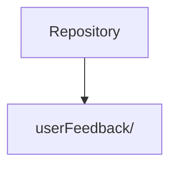

 

 

---

## What this is

CSS project with 2 HTML pages and 2 stylesheets: `index1`. Also checked in: 1 markdown document. The sections below are read from the repository itself, 6 tracked files as of 2024-10-31.

|  |
|:--:|
| **1** |
| docs |

---

## Architecture

Derived from the directories present in this repository.

---

## Project structure

| Path | Contents | Files |
|---|---|---|
| `userFeedback/` | — | 3 |

6 tracked files in total.

---

<a href="https://github.com/gowtham-creator/Complete-front-end">gowtham-creator/Complete-front-end</a>

