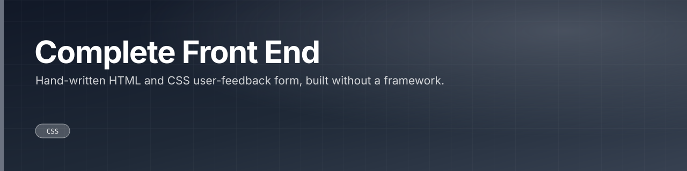
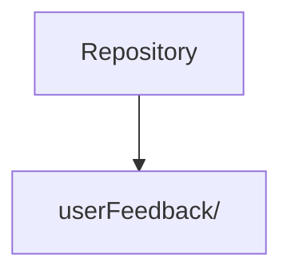

Hand-written HTML and CSS user-feedback form, built without a framework.

 

 

---

## What this is

A small static front end: a user-feedback form in plain HTML and CSS under a `userFeedback/` directory, with no framework or build step.

|  |
|:--:|
| **1** |
| docs |

---

## Architecture

Derived from the directories present in this repository.

---

## Project structure

| Path | Contents | Files |
|---|---|---|
| `userFeedback/` | — | 3 |

6 tracked files in total.

---

<a href="https://github.com/gowtham-creator/Complete-front-end">gowtham-creator/Complete-front-end</a>

